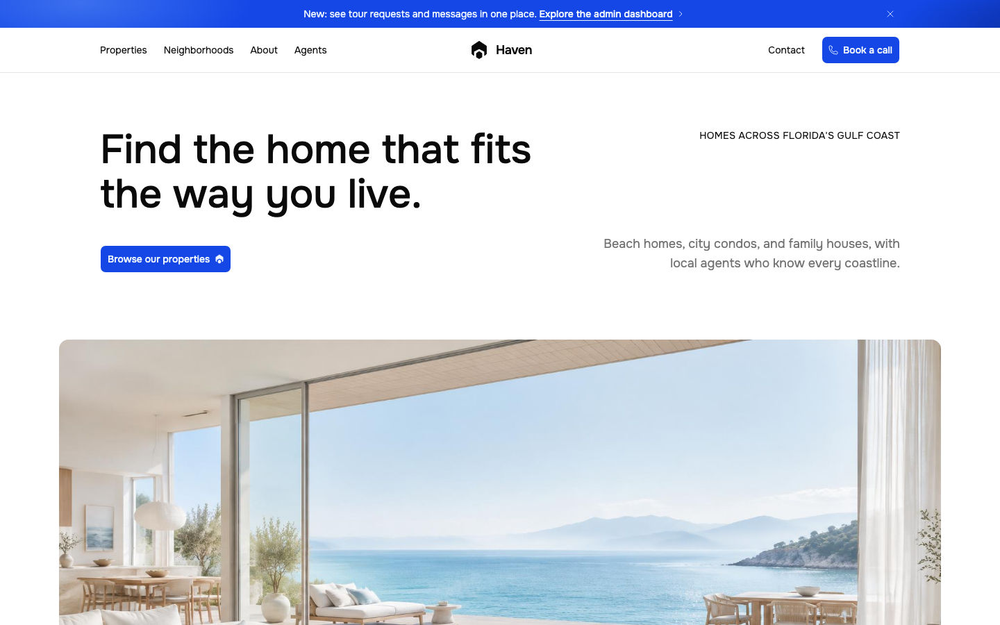
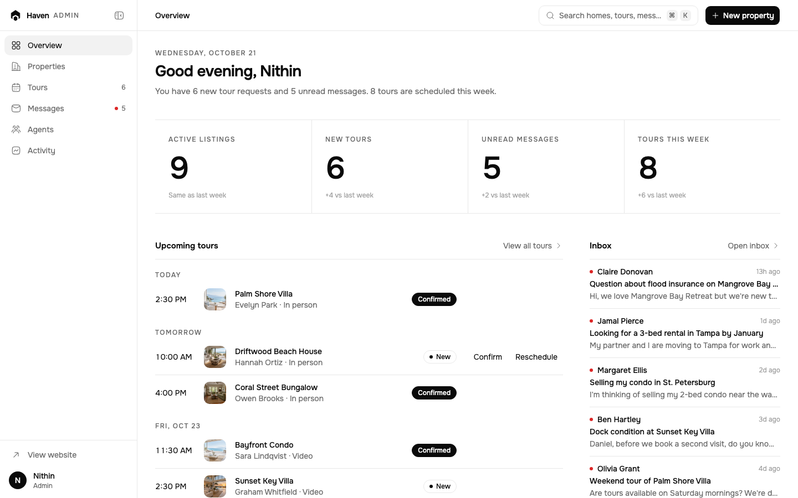
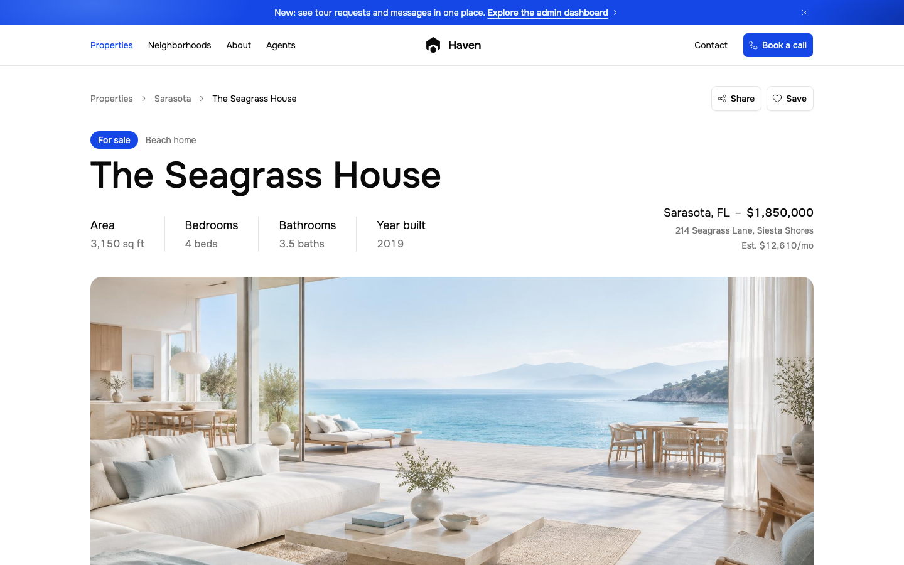
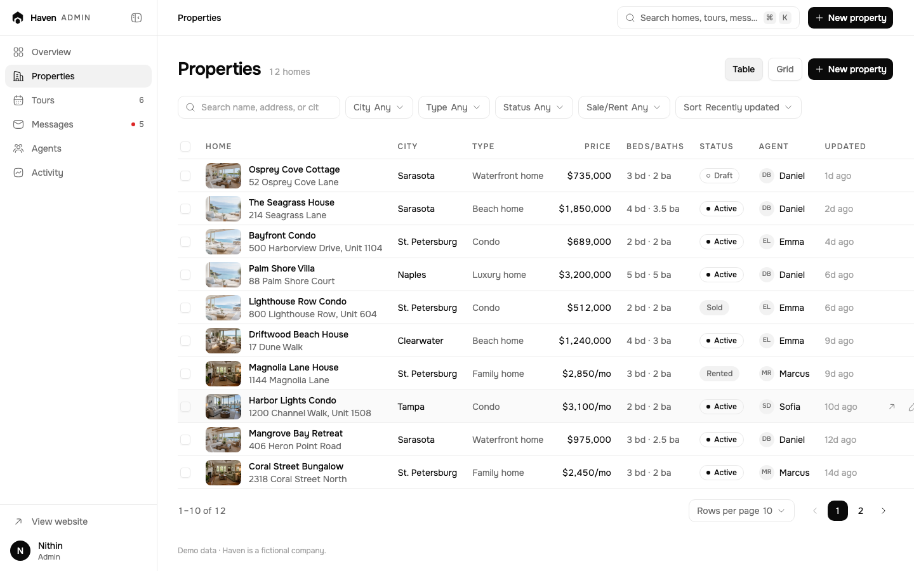

# Haven

**An open-source real-estate website and admin dashboard template.** It's built with React, TypeScript, Vite, and Tailwind CSS.

Haven is a fictional agency selling and renting homes on Florida's Gulf Coast. The template includes:

- **A public website:** listings with filters, home detail pages, neighborhoods, agents, guides, FAQ, and contact.
- **A full admin dashboard:** manage homes, tour requests, messages, agents, and an activity log.

Everything works in the browser out of the box. Connect your own backend when you're ready (see [docs/BACKEND.md](docs/BACKEND.md)).

> All names, homes, addresses, and reviews are fictional demo data.

## Screenshots

| Website | Dashboard |
| --- | --- |
|  |  |
|  |  |

## Features

**Website**

- Home page with featured and latest homes, property types, service area, reviews, and guides.
- Listings (`/properties`) with filters, sorting, and saved homes. Filter state lives in the URL.
- Home detail pages: photos, key facts, features, a mortgage calculator, move-in costs, and a "Schedule a tour" form.
- Neighborhood, agent, and guide pages; FAQ with search; contact form; privacy and terms.
- **SEO:** a unique title and description on every page, canonical URLs, Open Graph and Twitter cards, and JSON-LD:
  - `RealEstateAgent` and `WebSite` site-wide
  - `RealEstateListing` for homes
  - `Person` for agents
  - `Article` for guides
  - `FAQPage` for the FAQ
  - `BreadcrumbList` and `ItemList` where they apply
  - a generated `sitemap.xml` and `robots.txt`
- Accessible: semantic landmarks, labelled forms, keyboard support, and visible focus. Respects `prefers-reduced-motion`.

**Admin dashboard (`/admin`)**

- **Overview:** today's numbers, upcoming tours, inbox, listings breakdown, and recent activity.
- **Properties:**
  - table and grid views, with filters, search, bulk actions, and undo
  - a full editor with live preview, photo upload and reordering, validation, and an unsaved-changes guard
- **Tours:** list and week views, with a side panel to confirm, reschedule, complete, or cancel a tour, plus notes.
- **Messages:** a two-pane inbox with read/unread, archive, and notes, plus J/K/E/U keyboard shortcuts.
- **Agents:** an agent list and edit panel; listings get reassigned before an agent is deleted.
- **Activity:** a full log grouped by day.
- **Navigation:** a ⌘K command palette, keyboard shortcuts (press `?`), a collapsible sidebar, and a mobile drawer.
- Changes appear on the public site instantly, even across open tabs.

## Stack

| | |
| --- | --- |
| Framework | [React 19](https://react.dev) + [TypeScript](https://www.typescriptlang.org) |
| Build | [Vite](https://vite.dev) |
| Routing | [React Router](https://reactrouter.com) |
| Styling | [Tailwind CSS v4](https://tailwindcss.com) with design tokens |
| Components | [shadcn/ui](https://ui.shadcn.com) on [Base UI](https://base-ui.com) |
| Icons | [Hugeicons](https://hugeicons.com) |
| Motion | [Motion](https://motion.dev) |
| Forms | [React Hook Form](https://react-hook-form.com) + [Zod](https://zod.dev) |
| Font | [Onest](https://fonts.google.com/specimen/Onest) (self-hosted via Fontsource) |

## Quick start

Requires Node.js 20.19 or newer.

```bash
git clone https://github.com/jknithin36/haven.git
cd haven
npm install
cp .env.example .env   # then set VITE_SITE_URL
npm run dev
```

Open http://localhost:5173.

### Demo sign-in

Go to `/admin`. The demo email and password are filled in for you, so just click **Continue**. They're defined in `src/data/demo-auth.ts`.

> **The demo sign-in is client-side only.** Anyone who reads the code can see the details, and it doesn't protect anything. Replace it with real authentication before you deploy with real data ([docs/BACKEND.md](docs/BACKEND.md#replacing-the-demo-sign-in)).

To start over, use **Reset demo data** in the dashboard's account menu.

## Scripts

| Command | What it does |
| --- | --- |
| `npm run dev` | Start the dev server |
| `npm run build` | Type-check and build to `dist/` (includes `sitemap.xml` and `robots.txt`) |
| `npm run preview` | Serve the production build locally |
| `npm run typecheck` | Run TypeScript |
| `npm run lint` | Run ESLint |
| `npm run format` / `format:check` | Format with Prettier, or check formatting |

## Environment variables

| Variable | Used for |
| --- | --- |
| `VITE_SITE_URL` | Your public URL, without a trailing slash. It's used for canonical links, social cards, the sitemap, and robots.txt. Defaults to `https://haven.example.com`. |
| `VITE_API_URL` | Optional. Your API, once you connect a backend. |

## Project structure

```
├── docs/                    Backend guide and screenshots
├── public/                  Static files: images, icons, hosting config (_redirects, _headers)
├── scripts/seo-plugin.ts    Builds sitemap.xml and robots.txt
└── src/
    ├── data/                All content and copy: pages, homes, agents, guides, FAQ, admin text
    ├── store/               Data layer: properties, tours, messages, agents, activity, auth
    ├── pages/               One file per route (admin/ for the dashboard)
    ├── layouts/             MarketingLayout (website) and AdminLayout (dashboard)
    ├── components/
    │   ├── ui/              shadcn/Base UI primitives
    │   ├── admin/           Dashboard components
    │   ├── site/            Navbar, footer, announcement bar
    │   └── …                Website sections, grouped by page
    ├── hooks/               Small React hooks (URL state, filters, saved homes…)
    ├── lib/                 Helpers: formatting, dates, motion tokens, structured data
    └── index.css            Design tokens, theme, and type scale
```

## Customize it

- **Content.** Every piece of text, every listing, and every agent lives in `src/data/`. Change the brand name, navigation, and SEO defaults in `src/data/site.ts`. Components contain no hardcoded copy.
- **Design tokens.** Colors, radii, shadows, and the type scale (`type-display`, `type-heading`, …) are defined in `src/index.css`. The website uses white and blue. The dashboard switches to a monochrome theme through the `.admin-theme` class.
- **Photos.** Put images in `public/images/` and point to them from `src/data/`.
- **Social image.** Replace `public/og-image.png` (1200×630).

## Connect your backend

All reads and writes go through the modules in `src/store/`. They're backed by `localStorage` today. Swap them for API calls and the UI keeps working unchanged. [docs/BACKEND.md](docs/BACKEND.md) covers:

- every store, with its actions and types
- a fetch-based store example
- a suggested REST contract for homes, tours, messages, agents, activity, and auth
- how to replace the demo sign-in with real authentication

## Deploy

Haven builds to static files in `dist/`. Any static host works, as long as unknown paths fall back to `index.html`:

- **Vercel:** `vercel.json` is included (SPA rewrites, security headers, and `noindex` on `/admin`).
- **Netlify / Cloudflare Pages:** `public/_redirects` and `public/_headers` are included.
- **Others:** set the build command to `npm run build`, the output directory to `dist`, and a catch-all rewrite to `/index.html`.

Set `VITE_SITE_URL` in your host's environment settings, so the canonical URLs and sitemap point to your domain.

## Contributing

Issues and pull requests are welcome. See [CONTRIBUTING.md](CONTRIBUTING.md) and the [Code of Conduct](CODE_OF_CONDUCT.md).

## License

[MIT](LICENSE). Use it for personal or commercial projects.

The demo photos are placeholders. Replace them with images you have the rights to before you publish.
